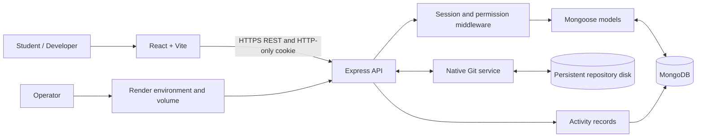

# CodeVault architecture

## Overview

CodeVault separates application metadata from native Git history. MongoDB stores accounts, repository metadata, membership, issues, reviews and audit events. Git stores the actual object database, refs, commits, trees and blobs.

## Runtime components

**Client.** React 18, React Router, Vite, Tailwind CSS v4 and Lucide. It presents authentication, workspace overview, repository explorer, files, commits, branches, issues, collaborators, pull requests, reviews and analytics.

**API.** Express exposes JSON endpoints under `/api`. Middleware applies Helmet headers, CORS origin validation, JSON size limits, cookie parsing, authentication rate limiting and a database connectivity gate. Protected routes require a signed JWT session cookie.

**Metadata database.** Mongoose schemas define User, Repository, Collaborator, Issue, Activity, PullRequest and RepositoryLock. Unique indexes protect usernames/emails, owner+repository slug, (repository,issue number), (repository,pull-request number), and collaborator membership.

**Git storage.** Every repository is a real Git repository located under `REPO_STORAGE_PATH/<repository ObjectId>`. Git commands are invoked with Node's `execFile` and an argument array, never shell interpolation. Git remains the source of truth for file trees, commits, refs, diffs and merges. `gitStorageAdapter.js` is the provider-facing local implementation for atomic ref compare-and-swap, generation tracking, idempotent operation records, crash recovery, verified bundle import/export and integrity checks. The current service uses it for repository path resolution, branch creation/deletion and backup export; remaining direct Git mutation paths will migrate incrementally. Adapter Git subprocesses re-check the active MongoDB lease before and after execution.

## Data model

- **User:** username, display name, email, password hash, profile metadata and active/disabled status.
- **Repository:** name, slug, owner, visibility, default branch, Git initialization state and timestamps.
- **Collaborator:** repository, user, inviter, role and accepted timestamp.
- **Issue:** per-repository number, title, description, author, optional assignee, status, priority, labels, comments and close time.
- **PullRequest:** repository, per-repository number, author, title/description, source and target branches, open/merged/closed status, reviews, merge commit and merge timestamps.
- **Activity:** actor, optional repository, action, entity type/id/name and summary.

Git objects are not duplicated in MongoDB.

## Portable repository backups

The repository backup endpoint is rate-limited to three downloads per IP per 15 minutes. It acquires the repository lease, creates a full Git bundle with all refs, verifies the bundle, enforces a configured size ceiling, calculates SHA-256 and then streams the immutable file to an authorized reader. The temporary bundle directory is removed after success, client disconnect or stream failure. The local `scripts/restore-git-bundle.js` utility verifies a downloaded bundle, imports all objects into a new bare repository, recreates its advertised branch/tag refs, sets the selected default branch and verifies object connectivity. It refuses an existing target and removes a partially restored target on failure. Only committed Git data is included; CodeVault's MongoDB accounts, collaborator roles, issues, pull requests and activity records require their own database backup process. This is a manual off-host backup path, not an automated schedule or remote storage provider.
## Authorization

| Role | Read | Create commits/branches/issues/PRs | Review PR | Merge PR | Manage collaborators |
|---|---:|---:|---:|---:|---:|
| Owner | Yes | Yes | Yes | Yes | Yes |
| Maintainer | Yes | Yes | Yes | Yes | Yes |
| Developer | Yes | Yes | Yes | No | No |
| Viewer | Yes | No | Yes | No | No |
| Public viewer | Public repositories only | No | May review public PRs | No | No |

Private repository identifiers are not authorization. Access is checked server-side for each request. Missing/private resources are returned as 404 where appropriate.

## Git storage adapter

The local adapter persists its operation journal and generation metadata under `.codevault-state/<repositoryId>` next to (not inside) the Git repository, so internal state is not exported in Git bundles. Ref changes use Git's atomic `update-ref --stdin` transaction with expected old object IDs. Operation IDs are payload-bound and replay-safe; prepared journal entries are reconciled by comparing every ref against the expected pre- and post-transaction values. A mismatch is treated as an ambiguous recovery state and blocks further adapter writes. The observed generation also hashes the current ref map, so legacy Git mutation paths are detected and advance the next observed generation. Fencing tokens are checked against the last accepted token. The adapter revalidates the live repository lease before and after each Git subprocess, including the final atomic ref transaction. Bundle imports write objects before atomically publishing refs, and repository verification runs Git connectivity checks.

This local adapter does not replace MongoDB's distributed repository lease. API mutations must continue to hold that lease, and the storage layer still resides on the configured local filesystem. It does not make separate per-instance disks consistent or horizontally scalable. The provider-neutral contract describes the later remote service boundary.

## Git operation safety

- Refs are validated before being passed to Git.
- File paths must be repository-relative and cannot traverse parent directories or access the internal `.git` directory.
- Text reads and single-file commits have explicit size limits.
- Repository mutations use an atomic MongoDB lease keyed by repository id. Each acquisition increments a persistent fencing counter; owners renew their lease with heartbeats and verify the owner token/fence before and after native Git commands. Release expires the lease but preserves the counter.
- Merge preview detects conflicts before a merge.
- Pull-request merge checks the target branch head observed by the preview and blocks outstanding change requests or missing independent approvals.
- In production, repository writes are blocked until `REPO_STORAGE_DURABLE=true` is explicitly set by the operator after attaching durable storage.

## Deployment model

Vercel serves the client. A Vercel rewrite proxies `/api/*` to the Render backend on the same origin, so browser session cookies do not need cross-site cookie settings. Render runs the Express API and connects to MongoDB Atlas. A persistent Render disk is required for repository Git data. The repository's current Render blueprint remains on the Free plan with `REPO_STORAGE_DURABLE=false`; production Git mutations are therefore rejected. Render Free does not support persistent disks. A disk-backed Render service is single-instance, so the MongoDB lease is a coordination foundation for a future shared-storage topology, not proof that Render disk-backed instances can be horizontally scaled.

## Future provider-neutral storage boundary

The current filesystem-backed Git service is not a portable multi-instance storage layer. The provider-neutral contract in [git-storage-provider-contract.md](./git-storage-provider-contract.md) defines the required storage adapter, service-to-service authorization, operation idempotency, ref compare-and-swap, crash recovery, backup manifest and provider integration test matrix. The preferred direction is a dedicated Git storage service; raw object storage must not be treated as a Git filesystem unless it proves Git-compatible atomic ref and locking semantics. This is a design only: no provider is selected, configured or deployed.

## Known limitations and next steps

The MongoDB lease coordinates workers only when they point at the same MongoDB database and the same shared repository volume. Separate per-instance disks are not coordinated. Git commands are checked against the current lease/fence before and after execution, but an already-running OS command cannot be forcibly fenced mid-invocation; keep the lease longer than the 20-second Git command timeout and the heartbeat comfortably shorter. Before multi-instance deployment, verify that the chosen shared volume supports atomic Git file/ref locking, exercise worker-kill recovery and run backup/restore drills. Isolated Git worktrees remain an option if the deployment platform cannot provide a common durable disk. Quota enforcement and independent security review are still required.
