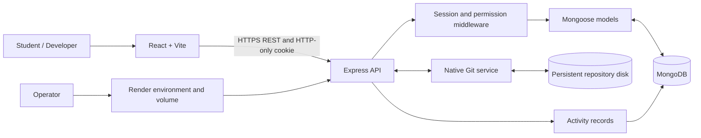

# CodeVault architecture

## Overview

CodeVault separates application metadata from native Git history. MongoDB stores accounts, repository metadata, membership, issues, reviews and audit events. Git stores the actual object database, refs, commits, trees and blobs.

## Runtime components

**Client.** React 18, React Router, Vite, Tailwind CSS v4 and Lucide. It presents authentication, workspace overview, repository explorer, files, commits, branches, issues, collaborators, pull requests, reviews and analytics.

**API.** Express exposes JSON endpoints under `/api`. Middleware applies Helmet headers, CORS origin validation, JSON size limits, cookie parsing, authentication rate limiting and a database connectivity gate. Protected routes require a signed JWT session cookie.

**Metadata database.** Mongoose schemas define User, Repository, Collaborator, Issue, Activity and PullRequest. Unique indexes protect usernames/emails, owner+repository slug, (repository,issue number), (repository,pull-request number), and collaborator membership.

**Git storage.** Every repository is a real Git repository located under `REPO_STORAGE_PATH/<repository ObjectId>`. Git commands are invoked with Node's `execFile` and an argument array, never shell interpolation. Git remains the source of truth for file trees, commits, refs, diffs and merges.

## Data model

- **User:** username, display name, email, password hash, profile metadata and active/disabled status.
- **Repository:** name, slug, owner, visibility, default branch, Git initialization state and timestamps.
- **Collaborator:** repository, user, inviter, role and accepted timestamp.
- **Issue:** per-repository number, title, description, author, optional assignee, status, priority, labels, comments and close time.
- **PullRequest:** repository, per-repository number, author, title/description, source and target branches, open/merged/closed status, reviews, merge commit and merge timestamps.
- **Activity:** actor, optional repository, action, entity type/id/name and summary.

Git objects are not duplicated in MongoDB.

## Authorization

| Role | Read | Create commits/branches/issues/PRs | Review PR | Merge PR | Manage collaborators |
|---|---:|---:|---:|---:|---:|
| Owner | Yes | Yes | Yes | Yes | Yes |
| Maintainer | Yes | Yes | Yes | Yes | Yes |
| Developer | Yes | Yes | Yes | No | No |
| Viewer | Yes | No | Yes | No | No |
| Public viewer | Public repositories only | No | May review public PRs | No | No |

Private repository identifiers are not authorization. Access is checked server-side for each request. Missing/private resources are returned as 404 where appropriate.

## Git operation safety

- Refs are validated before being passed to Git.
- File paths must be repository-relative and cannot traverse parent directories or access the internal `.git` directory.
- Text reads and single-file commits have explicit size limits.
- Repository mutations use a per-repository in-process lock.
- Merge preview detects conflicts before a merge.
- Pull-request merge checks the target branch head observed by the preview and blocks outstanding change requests or missing independent approvals.
- In production, repository writes are blocked until `REPO_STORAGE_DURABLE=true` is explicitly set by the operator after attaching durable storage.

## Deployment model

Vercel serves the client. A Vercel rewrite proxies `/api/*` to the Render backend on the same origin, so browser session cookies do not need cross-site cookie settings. Render runs the Express API and connects to MongoDB Atlas. A persistent Render disk is required for repository Git data.

## Known limitations and next steps

The shared Git worktree and process-local lock are suitable for a single service instance, not multi-instance writes. A production scale-out should use isolated Git worktrees or a distributed lock, plus repository-level quota enforcement, backup/restore drills and an audit of Git command resource limits. Releases/tags, source archives, notifications, full-text code search and an interactive conflict editor are not in the implemented scope.
