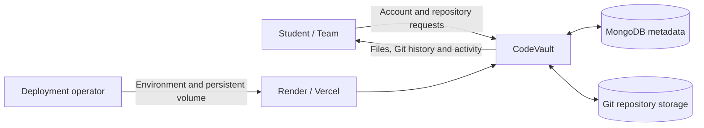
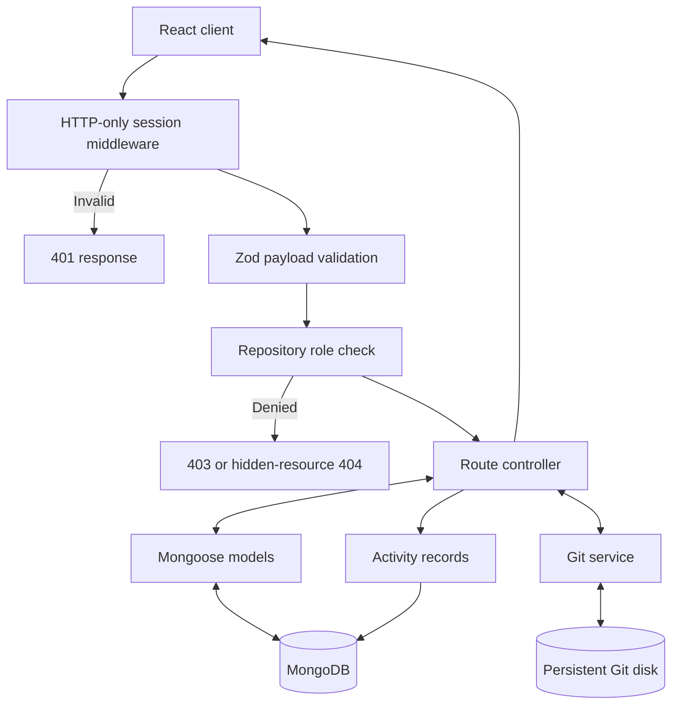
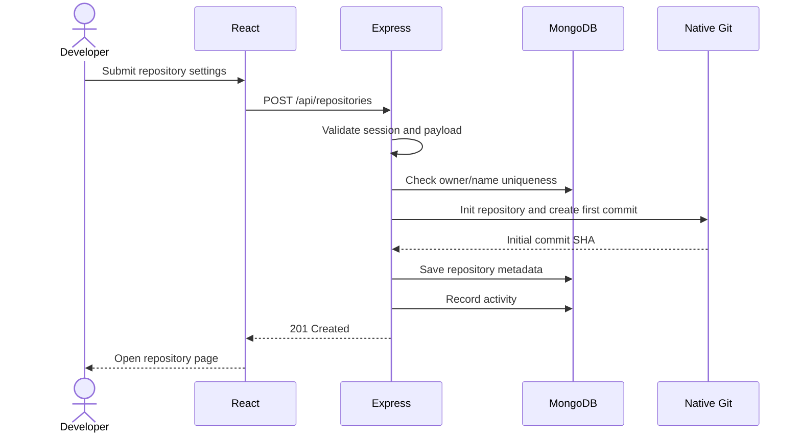
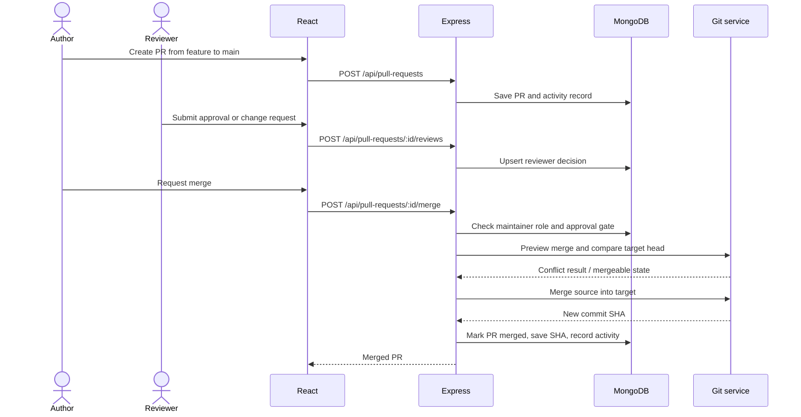
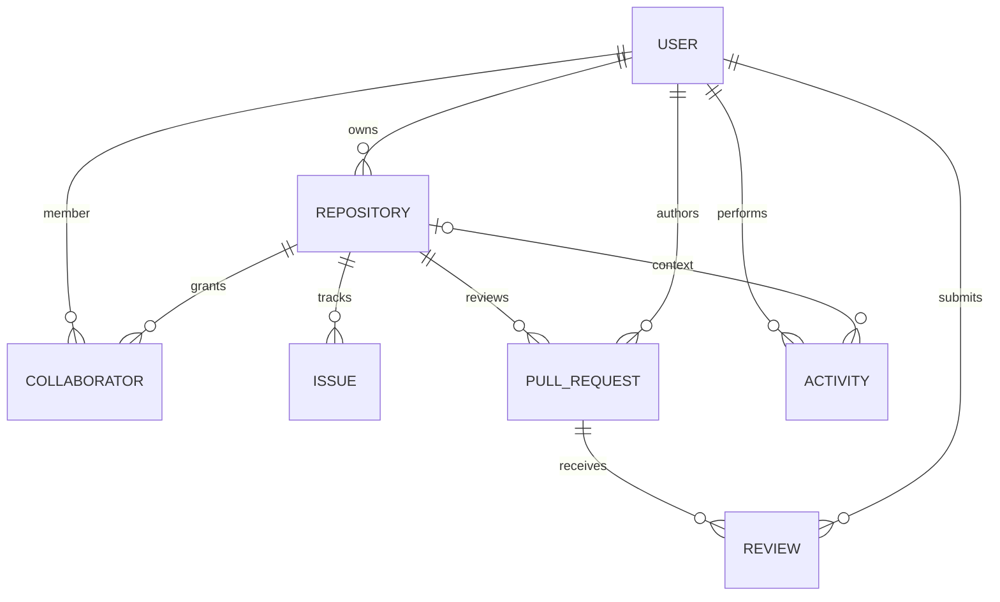
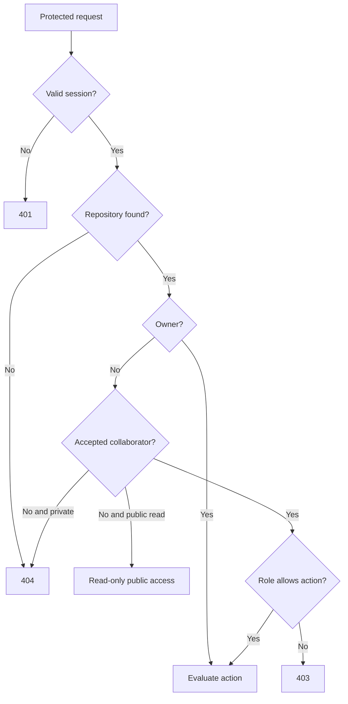

# CodeVault diagrams

## Context-level data flow

## Level-1 data flow

## Create repository sequence

## Pull-request review and merge sequence

## Entity relationships

## Permission decision flow

